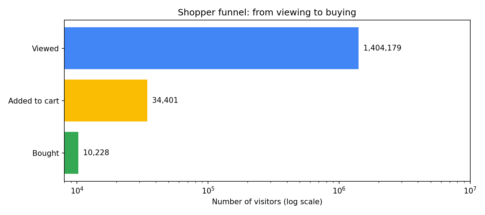
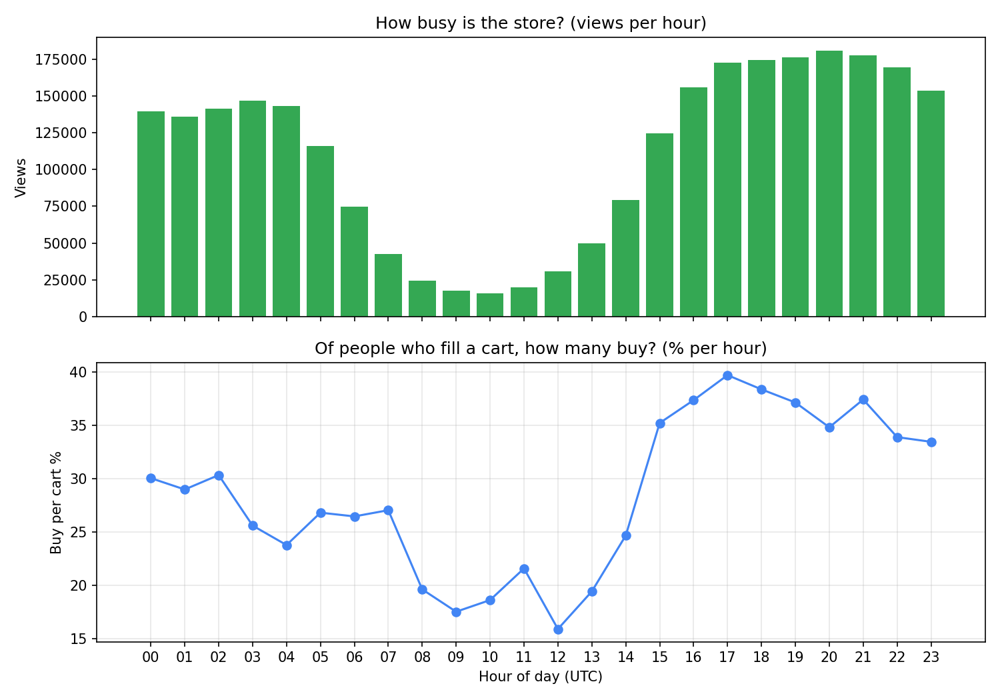
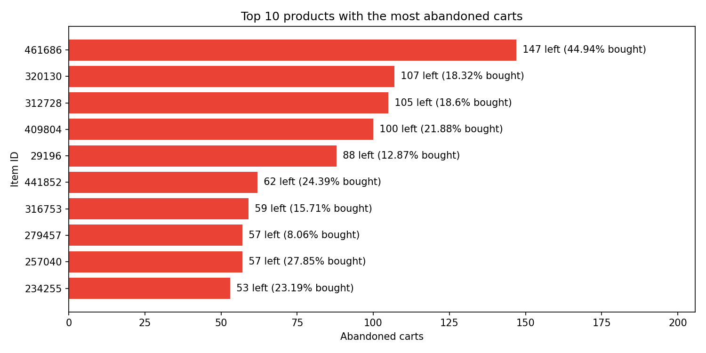

# E-commerce Funnel & Cart Abandonment Analysis

## Business question
Where do shoppers leave between viewing a product and buying it, and what should the company fix first?

## Data
Retailrocket e-commerce events dataset (Kaggle): about 2.76M events (views, add-to-carts, transactions) from about 1.4M visitors. Product names, prices and stock are hidden.

## Tools
Python, SQL (SQLite), pandas, matplotlib, Google Colab

## Key findings
1. **Funnel:** 1,404,179 visitors viewed a product, 34,401 (2.45%) added to cart, and 10,228 (0.73% of viewers) bought. Of people who filled a cart, 29.73% bought.
2. **Timing:** Buying per cart varies a lot by hour (UTC). It peaks near 40% at hour 17 and dips to about 16% at hour 12. Quiet hours have small samples, so those percentages are less reliable.
3. **Products:** The item with the most abandoned carts (461686) actually converts well (44.94%), so it is simply popular, not a problem. Eight other items convert below 20%, with item 279457 the lowest at 8.06%.
4. **Impact estimate:** If those 8 items reached a 30% cart-to-buy rate, that would mean about 99 extra sales.

## Recommendations
1. Investigate the 8 low-converting items for price, stock or delivery issues before changing anything.
2. A/B test a cart-reminder message during the midday hours when cart-to-buy is weakest.
3. Don't prioritize item 461686. High abandoned counts alone are misleading.

## Limitations
- Timestamps are probably UTC, not the store's local time.
- The 30% target is my own assumption (the overall average).
- The data shows where people leave, not why. The recommendations are hypotheses to test.
- The estimate covers only 8 items from the top-15 list.

## Charts

### 1. Shopper funnel

### 2. Store traffic and buying by hour (UTC)

### 3. Products with the most abandoned carts

